# jtx Board

**Journals, notes & tasks in one app — built on the iCalendar standard and synced with the CalDAV server of your choice.**

[](https://github.com/TechbeeAT/jtxBoard/releases)
[](https://f-droid.org/packages/at.techbee.jtx/)
[](LICENSE.txt)
[](https://crowdin.com/project/jtx-board)

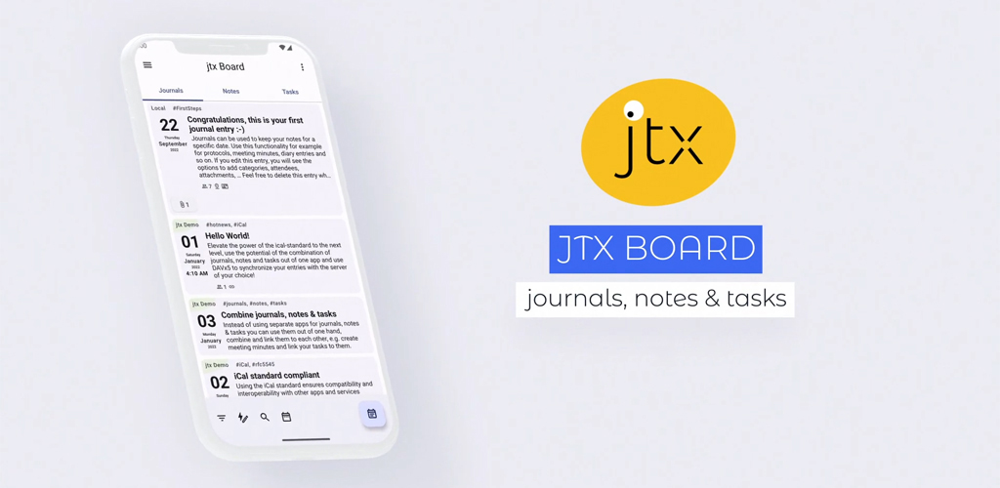

> [!TIP]
> **New from Techbee: [Spectacled](https://github.com/TechbeeAT/spectacled)** – open, standards-based journals, notes and tasks for **Android, iOS, Web and Desktop**, syncing directly over CalDAV without DAVx5.
> It's in public beta: [download it](https://spectacled.techbee.at/download/) or [join the test](https://spectacled.techbee.at/want-to-help-me-build-spectacled/)!

## Get the most out of journals, notes & tasks
Take the iCalendar standard to the next level: combine journals (VJOURNAL), notes (VJOURNAL) and tasks (VTODO) in one app and use DAVx5 to synchronize your entries with the CalDAV server of your choice!

### iCal standard compliant
Using the iCal standard ensures compatibility and interoperability with other apps and services, independent of a dedicated provider or infrastructure. Journals and notes are compliant with the definition of the VJOURNAL component, tasks are compliant with the VTODO component. You can also import and export your entries as .ics files.

### Combine journals, notes & tasks
Instead of using separate apps for journals, notes & tasks, you can manage them all in one place, then combine and link them to each other, e.g. create meeting minutes and link your tasks to them.

### Sync with DAVx5
Synchronize your entries with any compatible CalDAV server by using [DAVx5](https://www.davx5.com/). With DAVx5 you are free to choose your preferred CalDAV provider; you can even use your own local server to store and synchronize your data.
Note: DAVx5 is an independent app and must be acquired separately.

### Features
- Journals, notes and tasks in one app, linked to each other through parent/child relationships and subtasks
- List, grid, compact, Kanban and week views
- Alarms and notifications, plus location-based reminders (geofences, gplay flavor only)
- Attachments, audio notes and speech-to-text
- Markdown formatting
- Home screen widgets
- Import and export of .ics files
- Works offline with local collections, syncs through DAVx5 when you need it

**Find out more on [jtx.techbee.at](https://jtx.techbee.at/)**

---

## Download

[](https://play.google.com/store/apps/details?id=at.techbee.jtx)
[](https://f-droid.org/packages/at.techbee.jtx/)

The official jtx Board APKs provided on [GitHub Releases](https://github.com/TechbeeAT/jtxBoard/releases) are currently signed with a key with this SHA-256 hash:
```
8C:52:4F:E3:CF:6C:48:27:0D:A0:2A:F3:CD:9C:89:90:38:D7:B0:0D:2E:8C:9F:C1:C4:E2:6B:F3:2E:E8:69:70
```

## Screenshots
[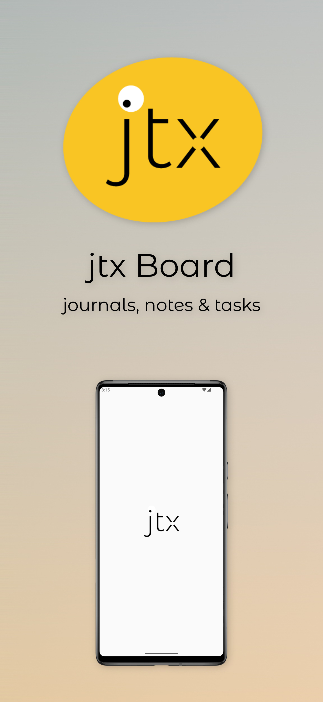](https://github.com/TechbeeAT/jtxBoard/blob/develop/fastlane/metadata/android/en-US/images/phoneScreenshots/screenshot1.jpeg)
[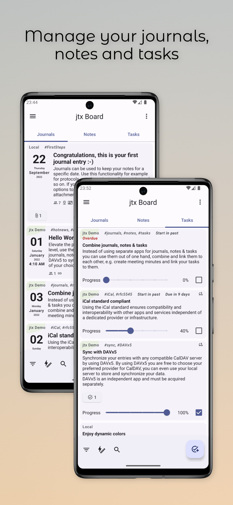](https://github.com/TechbeeAT/jtxBoard/blob/develop/fastlane/metadata/android/en-US/images/phoneScreenshots/screenshot2.jpeg)
[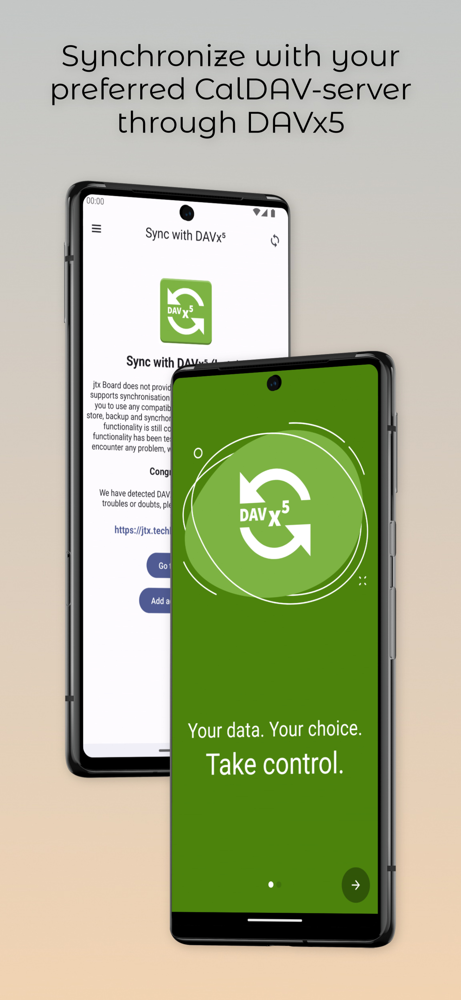](https://github.com/TechbeeAT/jtxBoard/blob/develop/fastlane/metadata/android/en-US/images/phoneScreenshots/screenshot3.jpeg)
[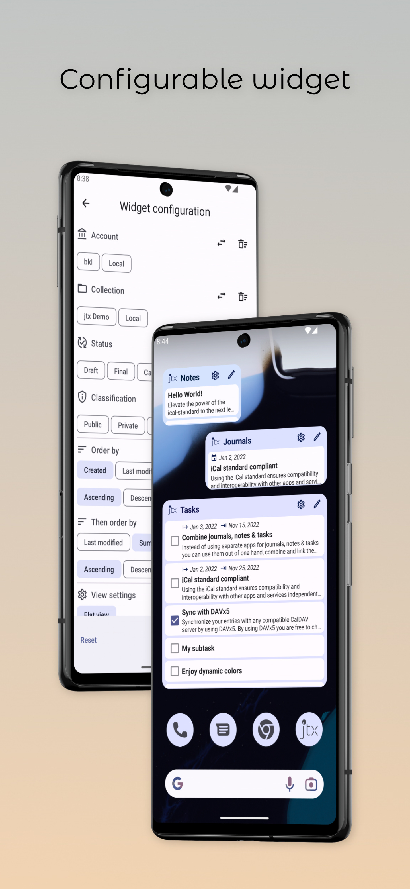](https://github.com/TechbeeAT/jtxBoard/blob/develop/fastlane/metadata/android/en-US/images/phoneScreenshots/screenshot4.jpeg)

<details>
<summary>More screenshots</summary>

[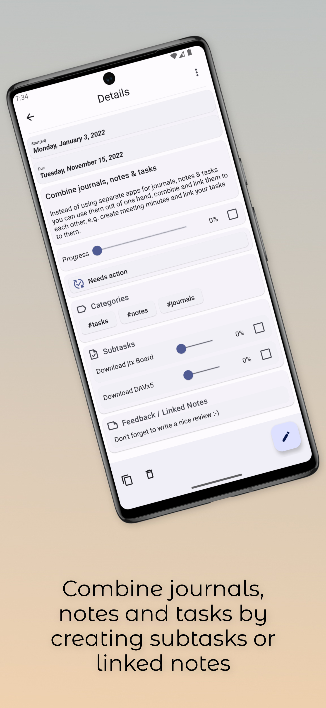](https://github.com/TechbeeAT/jtxBoard/blob/develop/fastlane/metadata/android/en-US/images/phoneScreenshots/screenshot5.jpeg)
[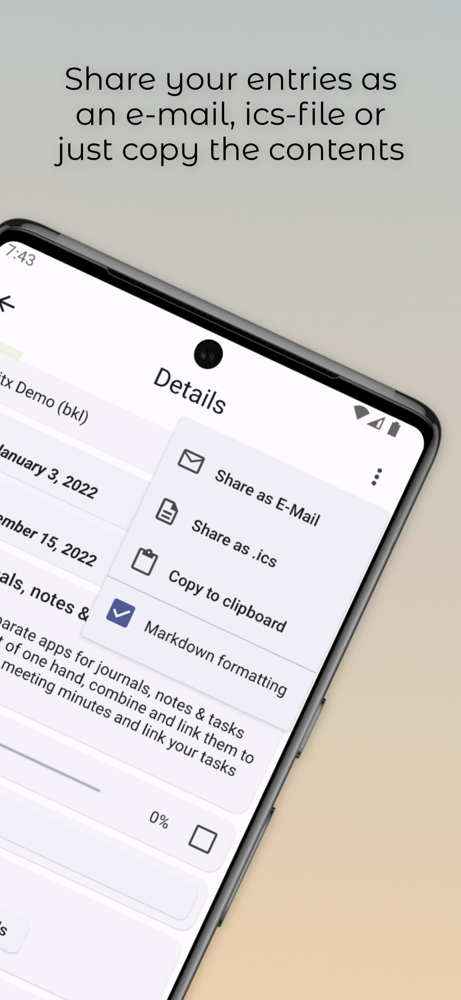](https://github.com/TechbeeAT/jtxBoard/blob/develop/fastlane/metadata/android/en-US/images/phoneScreenshots/screenshot6.jpeg)
[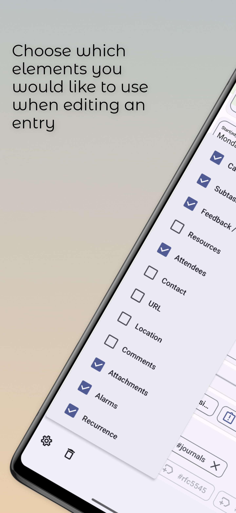](https://github.com/TechbeeAT/jtxBoard/blob/develop/fastlane/metadata/android/en-US/images/phoneScreenshots/screenshot7.jpeg)
[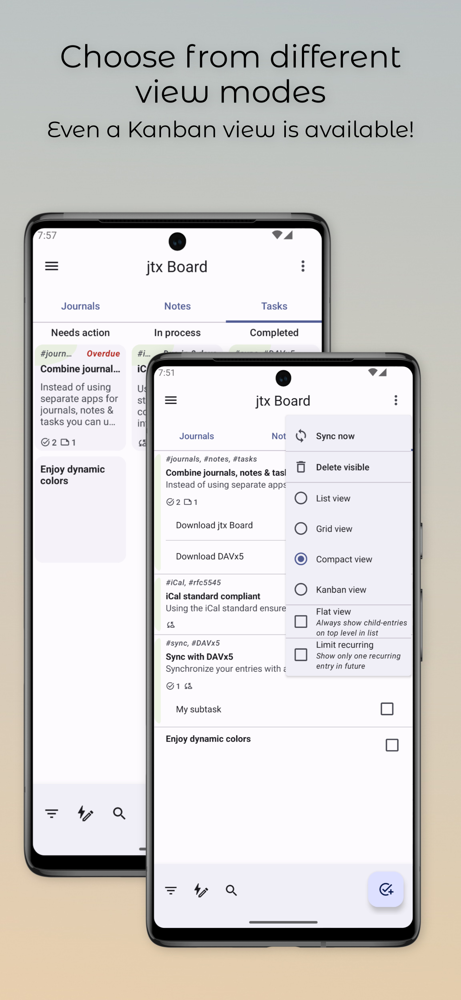](https://github.com/TechbeeAT/jtxBoard/blob/develop/fastlane/metadata/android/en-US/images/phoneScreenshots/screenshot8.jpeg)
[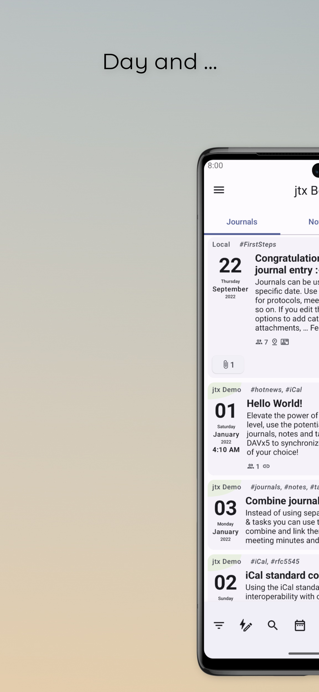](https://github.com/TechbeeAT/jtxBoard/blob/develop/fastlane/metadata/android/en-US/images/phoneScreenshots/screenshot9.jpeg)
[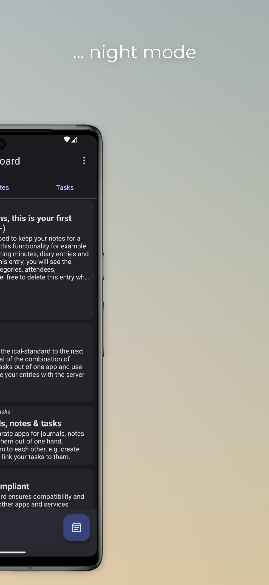](https://github.com/TechbeeAT/jtxBoard/blob/develop/fastlane/metadata/android/en-US/images/phoneScreenshots/screenshot10.jpeg)

</details>

## Troubleshooting
If you have any trouble with the synchronization, please first check the article [Troubles with the synchronization? See what could go wrong](https://jtx.techbee.at/troubles-with-the-synchronization-see-what-could-go-wrong) before opening an issue.

## Communication
To get in touch with the team and other users, please open an [issue on GitHub](https://github.com/TechbeeAT/jtxBoard/issues) or use the support form on [jtx.techbee.at](https://jtx.techbee.at).

## Contributing

Contributions are always welcome! Whether financial support, translations, code changes, bug reports, feature requests, or otherwise, your help is appreciated. For more information please have a look at [Contribute](https://jtx.techbee.at/app/contribute) on our website. Translations are managed on [Crowdin](https://crowdin.com/project/jtx-board).

[](https://www.paypal.com/donate/?hosted_button_id=KNCKKUUYN4FMJ)

[](https://ko-fi.com/K3K2GSCFJ)

## Building from source

Requirements: JDK 21 and the Android SDK. jtx Board runs on Android 7.0 (API 24) and newer.

```bash
git clone https://github.com/TechbeeAT/jtxBoard.git
cd jtxBoard
./gradlew assembleOseDebug
```

The APK is written to `app/build/outputs/apk/ose/debug/`.

### Flavors

jtx Board provides different flavors:
- **gplay** is the flavor for the Google Play Store. It comes in a standard and a pro version. The pro version is paid and enables editing options for remote entries.
- **huawei** is the flavor for the Huawei AppGallery. It comes in a standard and a pro version.
- **amazon** is the flavor for the Amazon Appstore. It comes in a standard and a pro version.
- **generic** (deprecated) was formerly used for other app stores. It contains only open source libraries and is meant to be paid before downloading.
- **ose** is the open source edition. **If you would like to build the app from source, this is the recommended flavor.** It contains only open source libraries. Instead of an in-app purchase, this flavor shows an additional page for donations. As Google Maps is not open source, the ose flavor uses OpenStreetMap.

## Permissions
jtx Board uses/requests the following permissions:

| Permission | Why it is needed |
|---|---|
| `GET_ACCOUNTS` | Determine if there are accounts set up in DAVx5 and show them in the UI |
| `RECORD_AUDIO` | Record audio notes and use the speech-to-text engine |
| `READ_CONTACTS` | Get suggestions when selecting attendees or a contact for an entry |
| `READ_SYNC_STATS` | Show a progress bar while a synchronization through DAVx5 is in progress |
| `INTERNET` | Retrieve the list of contributors for translations (Crowdin.com), code (GitHub.com) and release notes (GitHub.com) |
| `VIBRATE` | Haptic feedback when moving an entry on the Kanban board |
| `POST_NOTIFICATIONS` | Receive notifications when an alarm is due |
| `ACCESS_COARSE_LOCATION`, `ACCESS_FINE_LOCATION` | Move the map to your current location and set the current location (latitude, longitude) for an entry |
| `SCHEDULE_EXACT_ALARM`, `USE_EXACT_ALARM` | Show a notification when an alarm is due |
| `RECEIVE_BOOT_COMPLETED` | Restore notifications and geofences after a restart |
| `ACCESS_BACKGROUND_LOCATION` | Trigger a notification for a geofence (gplay flavor only) |

## License
jtx Board is licensed under the [GNU General Public License v3.0](LICENSE.txt).
